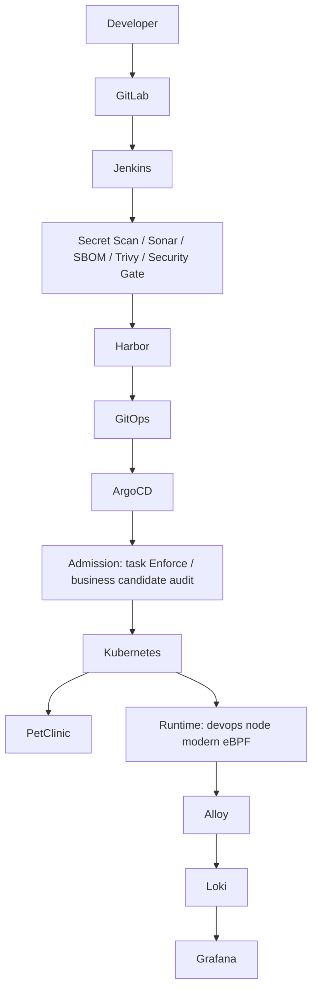

# DevSecOps 门禁与发布验收 · 2026-10-26

## 完整发布与独立复验结果

Jenkins **#207 SUCCESS**，完整执行1115.979秒。源码 `c68a142a6135c818c42103651c55b65239e1922a`；经私有GitLab正常promotion产生 `84d8ead98969861507f0edc6ce7a4e77c0e5360b`，版本 `0.10.0-ci-207`。Argo正常同步发布，未绕过原测试、Sonar、Harbor或GitOps流程。

|验收项|本轮实际结果|
|---|---|
|合规/违规准入|合规允许，7种违规均被指定Kyverno策略拒绝；仅server dry-run，不创建危险Pod|
|真实源码扫描|发现原始95项，逐项核验95项公开校验值误报，真实泄漏0；合成密钥拦截及空目录放行均通过|
|扫描隔离|有效UID65532、无token、根目录实际写入拒绝，可信Pod canary前后可达而扫描Pod连续两次被阻断；本轮节点API TCP不可达，但不据此宣称宿主防火墙隔离|
|扫描资源及回收|Pod source-207-849639，cgroup内存峰值132.42MiB，正常结束回收，最终扫描Pod0|
|SBOM|CycloneDX1.6，143组件、144依赖节点，JAR内外字节一致；SHA256 b0a9ab3d854212e8ff6ace34cfd683775ce32cac955b9d41e038dca78dc2b3f3|
|GitOps|22个CRD原生条件通过，实际策略spec与固定源码一致，Synced/Healthy；同步后重新执行准入测试|
|AMD64/ARM64 Harbor|两种架构各Critical0、High0、Medium53、Low4，原始57项；本轮fixable0，不声称全部漏洞清零|
|实际业务发布|3/3副本、BUILD_NUMBER207、UID10001、RuntimeDefault；实际根目录写入拒绝，临时目录写入/读取/删除成功|
|业务HTTP|首页、owners/find、vets、actuator/health均200，健康UP|
|消息与既有隔离链|RabbitMQ release-207事件成功消费；Kafka petclinic-release-v09发布事件delivered=true；Terraform独立plan、共享状态和失败/重试/超时清理均通过|
|监控|Grafana devsecops-control看板HTTP200、5面板；数据源查询HTTP200、控制器up=1|
|最终恢复|Jenkins非quiet且无运行构建，重任务Lease不存在或空，扫描Pod0，Spark Operator/Webhook保持Ready|

双架构索引摘要：`sha256:c8160221d55311268ae8654ffa7289ee9bffefea378dc8a0b43190e090c43ee1`。独立运行时检查的业务镜像与本轮扫描/发布证据完全一致。

## 资源实测与证据位置

#207全程42次资源样本：VM MemAvailable最低7678MiB，根盘空闲最低56986MiB，Mac内存余量最低36%，swap最大增长283.44MiB，未触及原512MiB停止线。结束后三次复查：VM可用约8.77GiB、根盘55.61GiB，Mac数据盘约56.73GiB、内存余量40%；CPU requests4645m/6000m。Kyverno实测15m/112MiB（单次top），扫描峰值132.42MiB。测量值不代表未来资源承诺。

私有原始证据目录：`/Users/zhangsir/Documents/New project/devsecops-20261026`。`ci-207/`保存完整阶段、控制台、42次资源记录和本轮Jenkins JSON归档；`final-server-audit.json`记录实际Pod/HTTP/Grafana；`final-resource-audit.json`记录最终资源与锁。失败201–205、中止206及205 safety-stop原件均保留；206按用户临时排查链路追踪要求正常中止，不记作功能故障。链路追踪的独立可访问性与同TraceID三存储对照另存`tracing-access-20261026`，未改已有hosts/Ingress。

## 本轮范围

在既有私有 GitLab、Jenkins、SonarQube、Registry/Harbor、Argo CD 发布链上增加源码泄漏扫描、生产依赖 SBOM 核对、隔离任务准入校验和发布证据关联。现有 Terraform 隔离、RabbitMQ/Kafka 业务链和按需分析流程保留。本轮不是全平台安全认证，也不替代此前分析验收记录。

新增常驻服务只有 `devsecops-system/kyverno-admission-controller`：Kyverno 1.19.2、官方 chart3.9.2、固定镜像摘要，单副本 Recreate。requests100m/192Mi，limits500m/512Mi；后台/报告/清理控制器关闭。`devsecops-execution` Gitleaks8.30.1 扫描 Pod 按需创建，requests100m/256Mi、limits1CPU/512Mi，600秒截止，只允许一个Pod、零PVC。结束按本次UID回收。SBOM复用已嵌入应用JAR的CycloneDX，不新增常驻服务。

## 门禁与证据

1. 原测试、质量门和重任务锁保持；扫描复用外层 Lease，不重复申请同一锁。
2. 实际 server dry-run：合规Pod允许；可变镜像、hostNetwork、hostPath、提权、缺失limits、token挂载、root身份七种违规被指定策略拒绝。
3. 扫描当前 Git HEAD 归档，不宣称覆盖全部Git历史。传源码前，验证Pod级网络探针连续两次阻断，且可信端探针前后可达；实际验证非root、无token、根目录只读。节点API TCP可达性独立记录，原生NetworkPolicy不等于宿主防火墙。
4. 随机合成的未签发token必须被检出，空目录必须放行；业务源码扫描结果保留原始计数及逐项误报。95项公开校验值（91项Helm SHA256、4项Go h1）按精确路径、规则和整行SHA256核对，不作目录或规则级忽略。新增/变化匹配仍阻断。
5. 逐字节核对JAR内 `META-INF/sbom/application.cdx.json` 与构建目录，验证CycloneDX1.6、组件唯一引用和非空依赖图。此为Maven生产依赖清单，不是全部OS软件清单。
6. GitOps固定源码commit，验证22个CRD原生Established/NamesAccepted、策略spec与Git完全一致，再执行准入负例。不忽略spec差异或更改全局健康规则。
7. 绑定源码、SBOM摘要、双架构镜像摘要及Harbor真实结果。证据目前未签名，不宣称Cosign或SLSA认证。
8. 业务候选在隔离命名空间审计；生产webhook未全局启用。经原Git Promotion后，实际业务启用只读根、RuntimeDefault、fsGroup10001与128Mi临时目录，须再验证HTTP和运行时行为。

## 失败历史与资源保护

201因原NoHttp测试发现重复地址字面量失败；202发现多文档部署解析错误；203探针发现节点API并非可靠的原生NetworkPolicy隔离边界；204发现策略默认值和Argo追踪标签漂移。均保留失败证据并修正实现，没有关闭原门禁。

205的新安全门禁、GitOps、双架构镜像及扫描均通过，但在Worker发布阶段，Mac swap较本轮起点增长约642MiB，超过原512MiB停止线，受控中止，不能标为完整发布成功。临时扫描Pod和Lease已回收，主业务继续运行原200版。结束后仅回收一次干净客机页缓存；没有删除持久文件，也不将约6.2GiB缓存逻辑大小写成净释放量。随后全新五次准入采样通过，才重新运行完整流水线。所有原资源阈值保持，不设置定时清缓存。

## 操作与排查

在 `jenkins.devops.local/job/petclinic-ci/` 选择 Build Now，执行整条链。不得直接从部署阶段跳过安全门禁。查看DevSecOps各阶段、测试报告、Console及 `.devsecops/*.json`：source-gate、admission-gate、business-template-audit、sbom-summary、gitops、release-evidence与cleanup记录。凭据/原始匹配文本不归档。

Grafana `grafana.devops.local/d/devsecops-control/` 提供控制器up、策略结果、内存、扫描CPU及范围说明。已有业务/发布/分析看板保留。

```sh
kubectl -n devsecops-system get pods
kubectl -n devsecops-system logs deploy/kyverno-admission-controller
kubectl get clusterpolicy devsecops-workload-contract
kubectl -n devsecops-execution get pods,resourcequota,networkpolicy
kubectl -n argocd get application platform-devsecops
```

发现真实密钥时先撤销/轮换并修复源码，再从头重跑；不要把真实泄漏加入误报清单。策略拒绝先核对具体规则与Pod模板，不全局关闭Webhook。扫描超时/网络探针失败先查对应记录和CNI，不放宽阈值。资源停止必须保留原样本，确认无运行中任务、锁已恢复并连续重新准入，才开启新一轮。

业务回滚沿用Git审查及Argo链：对明确的业务promotion提交作可审查回退，经原发布流程处理，不直接覆盖数据库或PVC。未知UID资源保留证据，不批量删除。控制器是单副本，升级短时不可用会阻断扫描命名空间的新任务；生产尚未挂该Webhook。ClusterPolicy API已deprecated，升级到移除旧API的版本前需迁移并重新验收。

## Phase 3结束时的未覆盖能力（历史范围）

以下为Phase3结论；本地限定范围运行时检测已由后续Phase4完成，仍不能等同全平台覆盖。生产全命名空间准入、宿主防火墙、全平台运行时威胁检测、集中漏洞处置、专用密钥管理/静态加密、签名准入、认证业务DAST和外部通知送达未因本轮被标为完成。Harbor必须同时报告严重级别及原始数量，不将扫描成功写成漏洞清零。

## Phase 4 - Runtime Security：完整验收通过

### 目标、基线与审计

本阶段在#207基础上增加可重复演示的运行时检测，不替代原有门禁。Jenkins **#214 SUCCESS**，总耗时1409.745秒；源码 `fbfa9d59cc7e0882f487d359119e4a04045e0d83`，私有GitLab promotion `deeb40746d86040d396321d70f91d4859d392ad7`，实际业务版本0.10.0-ci-214、镜像索引 `sha256:a8c03e462e44ec81d4b685dd88618ab5fd0b3847411ddcd067d8a92b2071e268`。最终独立检查的镜像与本轮扫描、promotion完全一致。

审计先于部署执行：nodes/pods/top、DaemonSet、Deployment、namespace、policy、events，k3s/containerd、内核BTF和BPF配置、采集配置、PetClinic模板及现有发布链均保存于私有preaudit.txt。审计时三节点均Ready：本地devops为ARM64、6CPU、约28GiB、Linux7.0.0-38；aliyun/ucloud为AMD64、Linux5.15。两个云worker已恢复Ready，但其eBPF实装兼容性**未验证**，本轮不在那里部署或迁移任务。未发现既有Falco/Sysdig/Tetragon/Tracee。

初始本地top为1921m、20898MiB，VM连续可用约8.7GiB，Mac内存余量37–41%；它们是时刻值。保留原15%+8GiB根盘、构建增长余量、Mac16GiB、内存余量10%、swap增长512MiB、PSI及OOM/Eviction停止线。未扩容，未删除业务或消息/数据库数据，Spark控制器保留；后续一次有证据的正常停机内存缩减见下文。

### 三层安全与工作原理

Build-time：Jenkins源码泄漏、Sonar、CycloneDX、Harbor/Trivy检查提交和软件镜像。Trivy发现静态CVE及组件风险，不能证明运行时没有异常行为。

Admission-time：Kyverno在API准入阶段评价资源。本平台Enforce仍限devsecops-execution，业务promotion候选执行同规则审计；不能把架构箭头解释成生产全命名空间已阻断。原7类真实准入负例在#214再次通过。

Runtime：Falco通过modern eBPF采集系统调用，将内核事件、进程状态和CRI容器元数据送给用户态规则引擎，匹配后输出带时间和字段的JSON。它是运行后的检测，本轮没有自动阻断、杀进程或自动隔离。



### 部署方式、eBPF与权限边界

官方chart9.2.1、Falco0.45.1，chartSHA256 `726c1fe08c3fd3e2789d4072b34f9eee94ecccad734fee471cc7546124570c6c`。ARM64原清单 `sha256:3c5ccde1c8b50ccc8baf016090a5376d182e08dc8751df2b37d8ff2a13499558` 转存原Registry，完整镜像自带container插件0.7.5。固定values、最终渲染JSON及SHA锁均在infra/security/runtime；原platform-devsecops Argo Application统一管理，无新Operator、Sidekick、metacollector或日志后端，禁止在线自动跟随更新规则。

modern eBPF程序嵌入Falco，利用BTF/CO-RE适配内核结构，通过BPF ring buffer传给用户态；本机实测可运行，故无需kmod加载、DKMS或传统按内核编译探针。当前chart驱动类型为auto/modern_ebpf/kmod，不采用旧版传统eBPF配置。本轮未更换runtime，CRI读取的是同一 `/run/k3s/containerd/containerd.sock`。

DaemonSet仅选择hostname=devops、arch=arm64，期望1个实例，hostPID、BPF/PERFMON/SYS_PTRACE/SYS_RESOURCE能力、Unconfined seccomp/AppArmor，无privileged=true、无API token；删除了chart中无用的boot/usr/etc/libmodules宿主挂载。可信agent仍可读取宿主进程及调用socket API，readOnly挂载不等于socket协议只读，这一高信任边界必须保留。传感器与restricted测试Pod的权限不同。

### 规则与已证实的噪音治理

8条规则均开启，只匹配petclinic/devsecops-test：Shell；passwd/shadow读取；包管理器；nc/ncat/netcat/socat；curl/wget；mount/setns/unshare或namespace工具；privileged执行/capset；etc/bin/sbin等敏感目录写入尝试。规则基于系统调用/进程/路径/容器条件与priority输出，不凭启动日志判断命中。

curl/wget为Notice可见性，不自动认定攻击；包管理器即使只执行--version也产生审计。首次CRI验收共检索223事件，其中worker的84条namespace/mount事件、12条capset、12条身份文件读取来自已观察的runc初始化，4条Shell来自已确认 `sh -c kill -0 1` 健康探针，归为expected behavior。它们不是84次逃逸或4次攻击。

仅针对已确认行为建立例外：指定namespace+container+镜像仓库+精确进程和命令；runc还要求可执行路径含runc。未关闭整条规则，也未全局忽略namespace。治理后最终测试批次7条实际事件：6类目标各命中，另外1条curl身份文件读取仍保留，标为expected behavior；规则命中的测试动作为controlled true-positive simulation。后续未知事件保留为待人工分类，不自动视为攻击或自动加入例外。

### 六类安全模拟及真实结果

测试namespace=`devsecops-test`，Pod=`runtime-20261027120458`，UID=`fd1ff304-e1a0-4bbc-a709-bf477ffe569d`；所有下表行均为此Pod/namespace。非root10001、只读根、drop ALL、RuntimeDefault、无token、默认拒绝网络；50m/128Mi请求、250m/256Mi上限、600秒截止，一轮仅1Pod。没有privileged测试Pod、外联、安装软件或真实逃逸。

|动作|实际命令|Falco rule|priority|真实UTC时间|结果|
|---|---|---|---|---|---|
|shell|/bin/sh -c printf runtime-shell|Platform Runtime Shell|Warning|2026-10-27T04:05:16.837372864Z|PASS|
|sensitive-read|/bin/cat /etc/passwd|Platform Runtime Sensitive Read|Warning|2026-10-27T04:05:19.489497706Z|PASS|
|package-manager|/usr/bin/apt-get --version|Platform Runtime Package Manager|Warning|2026-10-27T04:05:22.487968847Z|PASS|
|network-tool|/usr/bin/curl --version|Platform Runtime HTTP Utility|Notice|2026-10-27T04:05:25.050275502Z|PASS|
|readonly-write|/usr/bin/touch /etc/runtime-20261027120458|Platform Runtime Sensitive Write|Error|2026-10-27T04:05:27.756638412Z|PASS；EROFS阻止|
|namespace-tool|/usr/bin/nsenter --target 2147483647 --mount -- /bin/true|Platform Runtime Namespace Or Mount|Error|2026-10-27T04:05:30.306099270Z|PASS|

nsenter的exec成功产生事件，但工具最终因目标PID不存在退出1，未发生真实setns或逃逸；只读写入返回EROFS，为Prevented by container hardening，同时Falco检测到尝试。每项证据按rule、实际proc.name、动作时间绑定，避免将runc初始化误算成命中。成功逃逸、真实特权测试及所有capability分支**未验证**，也不执行。shadow读取分支未单独实测，实际敏感文件测试为passwd。

可重跑：`PETCLINIC_SSH_ADDRESS=192.168.64.11 python3 infra/security/runtime/verify.py /absolute/private/new-evidence-directory`。脚本持原共享Lease、暂停新Jenkins重任务并恢复原状态，不嵌套申请；finally按UID/owner删除，仅本轮Pod可被清理。保留空namespace/quota/default-deny作为可重复演示的零计算测试边界。最新清理证明测试Pod/Job0、privileged测试Pod0，不修改生产Deployment或对生产执行攻击/写入测试。

### Loki与Grafana

Falco JSON stdout → 既有Alloy独立标记片段 → 原Loki → 原Grafana数据源uid=loki。更新脚本先Alloy validate，再resourceVersion比较更新，只替换自有片段，原PetClinic/Cook/Worker采集链保留。日志标签namespace/pod表示sensor；被检测对象使用JSON中的output_fields_k8s_ns_name、output_fields_k8s_pod_name等字段，不混淆。

实际Loki查询 `{app="platform-falco"} | json | __error__="" | rule!=""` 已检索六类事件，具备rule/priority、k8s.ns.name、k8s.pod.name、container.name、proc.name、user.uid、evt.hostname、timestamp。旧预热噪音/失败轮日志未删除。正式渲染截图grafana-runtime.png另行核对，不能仅以数据源200替代分组显示。

既有看板 `grafana.devops.local/d/devsecops-control/` 共15面板，新增Runtime区域7个数据面板：总事件、严重事件、按规则/namespace/pod/node分组及最近事件。统计面板使用instant查询计算当前一小时窗口，分组以All values横向条形仪表逐行承接Instant向量，业务指标按当前规则哈希过滤，内部诊断跨版本单列；Kyverno UP查询明确限定kyverno-svc-metrics，避免把Falco当成Kyverno。7项Grafana数据源请求均HTTP200且有真实frame/正计数，分组的实际数据帧数量及计数保留在验收JSON（观测时刻值）。严重面板明确映射Error/Critical/Alert/Emergency：Falco没有名为High的优先级。看板总数包含历史预热与测试，不等于真实攻击数；没有伪造静态图。完整响应在grafana-runtime-audit.json。

### 负载、资源及诊断边界

Falco请求100m/256Mi，上限500m/512Mi，常驻CPU请求增量100m、内存请求增量256Mi；加上控制relay新增32Mi，总增量288Mi。负载采样46次，容器top实际CPU范围54–150m、working set范围73–95MiB；RSS指标另存原值。BPF内核映射不完全计入容器working set，VM/宿主连续记录补充整体评估。节点top是总工作负载浮动，不把前后差直接归因为Falco。

#214资源样本61次（Falco单实例规则滚动后3次top指标尚未发布，采样缺口原文单列于falco-load-metrics-214-errors.json；未填0或当作持续故障），最低VM可用4803MiB、根盘49.47GiB，Mac最低余量46%，最大swap增长0.00MiB。前轮#208的一次全量Pod列表采样超时、一次top因Kyverno指标缺失而退出均记录，恢复时保留原样本和原起点；之后独立复验继续定位出Kyverno实际RBAC故障，修复后重新执行#214，未以该轮SUCCESS替代最终健康。因交付时距昨夜CI验收超过8小时，保留CI214/独立初验原件，另执行delivery-20261027-acceptance新批次并核对当前状态；不把默认一小时窗口的过期无数据当成故障。最终三次复核CPU请求4745m/6000m、VM可用5.49GiB、根盘48.66GiB、Mac数据盘43.50GiB。空闲值不是持续保证；既有Airflow联合任务本阶段未重跑，新增请求必须按原新鲜预算重新准入，不能并行强开重任务。

实际负载样本的内核 `scap_n_drops_total` 和输出队列drops为0；`scap_n_retrieve_evts_drops_total`非0。已核对[官方parser源码](https://github.com/falcosecurity/libs/blob/cea7e1d4fa6f64d3855a8e37d784088ae4846891/userspace/libsinsp/parsers.cpp#L556)：它是入口事件不存在或与退出事件不匹配的用户态状态计数，不能等同ring-buffer丢失，也不能据其他计数0声称无损。其对所有未测试系统调用上下文的完整影响**未验证**，保留原值继续观察，未关闭计数器掩盖它。

首次启动ARM64旧open/creat tracepoint缺失，Falco提示检测继续，但相应TOCTOU加固有限制；实际openat检测/六类测试通过。最终CI窗口内Falco当前Pod无CrashLoop、无重启、最后5分钟无持续driver/eBPF/规则加载错误（本阶段正常VM重启单列记录），Prometheus Falco target up=1。不把这些有限测试推广为所有攻击必检。

独立检查还保留了`Unable to determine path for file descriptor ... readlink ... No such file or directory`及Permission denied两类日志。后者不能解释为进程退出竞争，也未通过增加权限来消音。实际falco --version确认libs0.26.1，官方0.45.1构建配置默认依赖0.26.1，其标签固定到cea7e1d4fa6f64d3855a8e37d784088ae4846891；以该精确源码重新校准此前对另一提交的解释。threadinfo.cpp867明确以SEV_INFO记录FD缓存缺失后的/proc回退查询失败，并返回空路径；scap_procs.c1969保留readlink的errno。因此它不是driver/eBPF加载错误，不把关键词failed一概归为driver故障。日志未删除、日志级别未下调；最终审计单列其原文和数量，未知error/fatal仍使审计失败。所有未测系统调用的完整路径关联能力**未验证**，不宣称全量无损。

交付时的实际top（与上述CI窗口采样时间不同）：

```text
kyverno-admission-controller-848fb9647d-8s5zj   10m   67Mi
platform-falco-ldh8p                            75m   105Mi
```

### 独立复验揭示并修复的Kyverno故障

#208流水线SUCCESS，但随后独立检查发现Kyverno CrashLoop，前次日志明确为读取CRD被403拒绝。根因是Argo追踪将顶层instance改为platform-devsecops，而聚合角色仍匹配kyverno，官方core角色13条权限失去聚合。故障日志、原聚合角色和失败健康证明保留，不把#208成功当作独立验收通过。

修复只对齐顶层标签和聚合选择器，保留官方原有权限，没有新cluster-admin绑定；更新清单摘要锁，新增模拟Argo改标签的复现测试及ServiceMonitor选择器测试。通过原Argo应用同步后，实际SA的两项CRD读取均allowed、13条core规则存在、控制器重新启动Ready并恢复Healthy。初次恢复等待超时也保留，最终重新验证完整22 CRD原生条件与策略spec。新增DevSecOps Final Health，在整轮末尾检查实际权限、Argo、7准入负例与Falco短健康；普通Runtime事件仍不导致CI失败。修复源码为53f6e1e10ee4774c46100b99013ef83af226397c。

### 构建期资源修复与边界

#209因原Mac swap增长512MiB线受控中止，完整CI未通过，原样本与ABORTED归档保留。Docker已受5/6GiB内存预算且当时仅约0.28GiB，未盲目改动。一次watermark_scale_factor=300后台水位试验触发内存full PSI停止线，自动恢复原10，没有持久化采用，也未降低保护线或设置balloon target/改变VM容量。

实际减负复用已有Sonar暂停机制：本次Maven报告任务SUCCESS、原质量门OK、已有监控接口待处理0、Jenkins已知入口无其他构建，才在当前外层Lease中暂停Sonar。明确只核验已提交任务及全局pending；无全局CE管理员权限，对平台之外未登记的外部运行中扫描**未验证**，不扩大权限或宣称全局活动清空。保留sonarqube-data PVC与原StatefulSet UID；记录holder、原副本和quiet状态，直到同UID恢复Ready、HTTP UP及质量结果后，才释放锁并移除精确holder的队列保护。中止/失败也走同一恢复，失败不释放保护。最终使用已有Jenkins扩展点QueueTaskDispatcher临时阻止新队列任务，只放行同一Job/Build的续行；不修改作业配置或进入全局quiet模式。核心Queue.Item实测新构建拒绝、本轮续行允许、其他续行拒绝，且没有入队或创建测试Job。增加所有权及队列参数测试。独立试验VM可用8.43→10.30GiB（约1.87GiB），随后恢复成功。

测试还确认原github-webhook-relay上限96MiB导致历史66次OOM。仅将已有relay调为requests64Mi、limits192Mi（CPU5m不变），镜像/凭据/副本保留，部署脚本及精确UID保护进入Git；受限24Mi Node客户端与并发控制验证后新Pod保持正常。无新控制组件，新增内存request合计为Falco256Mi+relay32Mi=288Mi。失败锁按UID/holder、SonarReady且无残留进程证明后才恢复，记录slot-guard-recovery.json。

#214实际运行时的暂停/恢复及Jenkins队列恢复见.devsecops/sonar-resource-slot.json，恢复后原质量门结果另存sonar-restored-quality.json；全程原阈值保持。Sonar只在本轮CI扫描后的闲置重任务窗口暂时0副本，末尾恢复原1；必要业务、消息、监控与安全控制器一直保留。

#210业务测试104项通过，但合成凭据自检未命中，构建FAILURE、未执行发布；扫描Pod和外层Lease均正常回收。修复随机样本生成：使用36个互异的字母数字字符，保持固定工具的原始规则与熵门槛，自检失败也先保存脱敏发现；1000次生成性质测试通过，真实隔离Pod验证合成样本阻断、空目录接受、源码95项精确基线无新增阻断并自动清理。不弱化secret gate；该轮失败不冒充发布成功。修复源码e74d3affa55f534390a62d093121f73070a7e9f9。

#211在Sonar质量门通过后，原生quietDown让活动Pipeline停在阶段边界并超时ABORTED。已取消仅本轮quiet状态，post实际恢复Sonar1/1 Ready/HTTP UP并释放锁，证据保留；不以该轮通过的前置阶段冒充整轮成功。最终改为上述临时队列veto，源码52c73539747e98fd86d807b2bb605acf5f44b557；Jenkins重启时该内存扩展不持久化，恢复时须先核对Sonar、原Lease及所有权，不宣称跨重启高可用。

### 宿主与VM容量修复

#212在业务滚动、健康和RabbitMQ事件通过后，Mac swap累计增长568.44MiB触发原512MiB停止线，最终ABORTED，未将已发布业务冒充整轮CI通过。原基线、资源样本、终止及post恢复证据保留；Sonar实际恢复UP、队列veto解除且Lease释放。#209失败计算Job遗留在保存元数据/CI日志、核对精确UID/Failed及无Pod后单独回收，未删共享状态或PVC。

Mac物理32GiB、原VM28GiB，观察压缩器约16.9GiB；当VM MemAvailable仍约10GiB时宿主仍新增swap，单看客机Available不足以证明宿主安全。现有Pod内存requests约20294MiB；本轮持维护Lease、Jenkins空闲后正常systemctl poweroff，等待UTM stopped，退出UTM释放配置缓存，保存完整原配置及SHA，仅将System.MemorySize 28672→24576MiB，其他字段逐项完全一致。6CPU、258GiB主盘、网络、数据及服务requests/limits保留；没有强制断电、暂停快照、balloon target或反复drop_caches。

Linux重启后MemTotal24546064KiB，三节点Ready、业务3/3及全部必要控制器恢复。计划重启产生的Falco/relay原Pod各一次重启记录完整保留；只按UID正常重建这两个临时Pod，重新建立原CI的零重启进程基线，并非掩盖OOM。Kyverno历史累计重启11，当前进程始于2026-10-26T18:11:55Z，早于最终CI开始，未声称全历史为0。五次恢复样本VM可用6185–6402MiB，Mac内存余量49–51%，swap1991.56MiB保持不变；确认业务/API和原阈值后才释放维护锁并恢复原Jenkins调度。

当前资源期望为24GiB/6CPU，不再沿用旧28GiB容量预算。后续分析联合任务必须重新核对完整预算，不能按旧的瞬时10–12GiB余量准入。内存缩减可通过正常停机、恢复私有原配置并重新启动回退；原件保留在vm-memory-24g，未删除。全程停止线不降，#214成功与否以最终完整运行及独立证据为准。

### 最终显示与噪音治理复验

#213完整SUCCESS（1197.740秒），6类模拟、实际Loki与业务复验通过；但独立浏览器检查发现Instant分组向量被Calculate归约到末行，不能以数据源200冒充所有分组显示。网页未保存预览切换All values后，8条真实规则及各自计数均可见；正式修复进入Git，4个分组面板明确values=true、最多50行，最终再经完整#214与实际页面验收。

同期一小时原始666条记录被逐进程核对：632条来自固定k3s runc启动，6条是生产清单已声明的sh -c sleep 5停止钩子，1条为worker隔离单测的审计Shell，18条Java敏感身份文件访问未因进程名而放行，7条本轮安全模拟，2条内部丢弃报告。历史Java记录缺少具体文件路径，不能据此认定全部是正常passwd查询；因此只保持可见并补充后续敏感读写evt.arg.name输出，重跑测试要求真实路径与动作一致。未关闭任何规则，也未对整个业务namespace或Java进程加白。

最终启动例外固定宿主runc完整路径、进程名、3个精确cmdline、namespace、container和镜像仓库；范围补足已经取证的业务容器及CI tests容器，同时把原contains runc收窄为固定路径，容器自建/tmp/runc不在例外内。仅另排除精确已配置的生产停止钩子，其余Shell继续检测。受限测试Pod的runc启动也必须不产生业务告警，6类目标仍命中。

规则SHA派生12位版本标签，由固定chart离线渲染脚本自动写入Pod、锁与看板；Alloy仅增加该标签，业务统计选择当前规则版本及source=syscall、Platform Runtime规则前缀。旧版本日志和全部内部诊断仍保留，故障查询用{app="platform-falco"}回看；没有清日志或重置告警伪造降噪。新增独立内部drop日志面板跨所有版本，避免把缺namespace的内部事件混入业务分组。chart及最终JSON双重固定，连续两次渲染字节摘要一致；原生Falco --validate无错误/警告。

真实历史丢弃也单列：正常VM重启期间旧传感器platform-falco-wdlhl于2026-10-26T18:12:37Z、18:13:23Z报告两次ring-buffer溢出，合计40881个系统调用；实际Loki stream Pod标签及新Pod创建时间证明发生在#213新进程窗口之前。startup-drop-reports.json完整保留；不以新进程采样0声明整阶段无损。冷启动所有事件完整性**未验证**，本轮最终6类演示与CI负载窗口分别按真实证据验收。

最终版本59752c1132f0在#214绝对时间窗的独立Loki复核共13条业务记录：7条安全测试、6条Java读取/etc/passwd，runc启动与已配置停止钩子告警均为0；没有因Java进程名而关闭检测。交付新批次再次得到7条/6类命中，路径精确对应，当前一小时内无内部丢弃报告；这不抵消已经归档的两次启动丢弃，也不证明所有未测试调用的完整性。查询起止范围分别保存于loki-ci214-ruleset-audit.json和loki-current-ruleset-audit.json。

### 完整CI、业务与恢复

Jenkins petclinic-ci #214经Build Now完整SUCCESS，原测试、源码泄漏/准入/SBOM、Sonar、GitLab审计、双架构、Harbor、Git Promotion、Argo、健康、RabbitMQ/Kafka事件、Terraform隔离plan/共享状态/失败重试和超时清理全部通过。runtime-health.json仅短查实际healthz、单实例、摘要、重启，不等待攻击或因普通告警使CI失败；logging脚本保证重跑幂等。

本轮真实源码泄漏0，原始95项、逐项校验95项公开SHA/Go校验值误报（新增Falco注解未产生实际发现，先前预留的3项未使用条目已删除）；没有目录/规则级忽略。Harbor两种架构各Critical0/High0，仍各Medium53/Low4，范围为本轮业务镜像，不声称整个安全平台漏洞清零。

独立业务检查：214版3/3、UID10001、原只读根/RuntimeDefault配置保留；首页、owners/find、vets、health均200/UP。生产没有执行攻击或写入验证，原#207实际只读证明保留，本轮写入防御测试只在隔离Pod完成。PetClinic与platform-devsecops两个Argo Application均Synced/Healthy；Kyverno正常且7负例通过；Spark Operator/Webhook Ready。最终测试Pod/Job、源码扫描Pod0、Jenkins非quiet且无构建、共享Lease空/不存在。

交付资源边界：根盘可用以最终新鲜样本为准，下一次安全镜像重构建的原启动要求为49.778671GiB（原15%+8GiB停止余量再加4GiB增长）。交付检查若低于此值应由原准入门拒绝，而不是降低阈值；#214已经在满足当时准入的窗口完整成功，不代表有限磁盘能无限重复构建。新镜像/卷/业务备份未擅自扩大清理授权。Mac DNS页面实际返回200，实测首访约5–10秒，未把HTTP成功声称为低延迟SLA；DNS/访问延迟的独立根因**未验证**。

### 排障、回滚与面试演示

先看Jenkins .devsecops/runtime-health.json、runtime-logging.json，再看 `kubectl -n devsecops-system logs ds/platform-falco`、DS/Pod状态、Prometheus target和drops；字段为空优先核对CRI引擎及k3s socket，不重复安装驱动。错误按启动时间区分一次性ARM64兼容警告与持续失败。Loki查app=platform-falco后按实际output_fields过滤，不把sensor命名空间当受检namespace。Grafana无数据先核对时间窗、Loki链和真实query响应，不造图。

回滚走可审查Git revert和原Argo链，禁止改数据库/PVC。当前prune=false：单纯移除资源清单不会删除已部署Falco，必须核对owner后显式清理本轮Falco DS/Service/ServiceMonitor/CM/SA，并仅移除标记Alloy片段；其他采集源和Kyverno保留。删除测试namespace前核对owner及空资源。升级先固定版本、重跑6类测试、观察噪音/资源，再正常CI，禁止自动更新未审查规则。

面试讲解：提交进入私有GitLab后由Jenkins完成构建期门禁，Argo同步经过审计的期望状态，Kyverno负责当前限定范围的准入；运行后的系统调用由本地Falco观测，CRI补齐Pod身份，Alloy把真实JSON送入Loki，Grafana按规则与工作负载查询。我能现场在隔离namespace执行6类安全演示并展示同Pod/同时间告警、只读防御和自动回收；不把规则命中说成真实入侵，也不把未覆盖云节点或全量无损说成完成。

证据目录 `/Users/zhangsir/Documents/New project/falco-20261026`：preaudit、readmission-214、delivery-20261027-acceptance、loki-audit、grafana-runtime-audit、falco-load-metrics、counter-interpretation、ci-214、final-server-audit、final-resource-audit。CI归档与最终部署证明可关联准确source/image；临时原始日志未提交Git。
