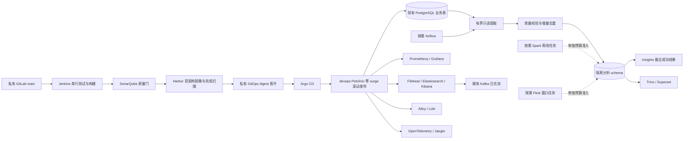

# Petclinic 业务统计与私有发布链升级 · 2026-10-11

状态：实施中；本文件不能当作发布完成证据。最终以 Jenkins、镜像摘要、GitOps revision、浏览器与查询结果为准。

## 已完成的具体变更

- 保存原工作区 HEAD、未提交 patch和清单；另建隔离工作树，保留原用户修改及未推送历史。
- Redis原件备份/校验后，在备份副本核实末尾135个零字节损坏，经用户明确授权才截除原AOF该尾部；前面的有效记录字节不变。Redis实际BGSAVE成功、AOF写入正常，Harbor各组件health=healthy。未变更Redis版本/架构、PVC或现有镜像。
- 私有GitLab `root/petclinic-platform` 已从镜像改为源码/发布主来源；现有Jenkins任务及历史保留、SCM改用现有GitLab凭据、添加Petclinic视图；Argo同一应用迁移到同一私有来源。迁移时保持原业务镜像和数据库不变，不推送内部资料至公开GitHub。
- 新增 `/insights`：日期筛选、登记就诊趋势、宠物类型分布、业务汇总、最近成功更新时间，明确演示数据、部分覆盖、空数据、加载和失败状态。分析失败保留成功结果，核心业务不依赖分析服务进程。
- PostgreSQL一致性custom dump先于新增schema；仅新增隔离 `petclinic_analytics` schema、分析/只读角色。分析账号仅SELECT业务表，结果独立发布；业务表DDL、已有记录和PVC均保留。
- 真实有界任务读取1200条已有就诊记录，以主键增量、去重、校验、事务发布；重复执行不重复计数。现有源数据时间范围2008-09-04至2026-10-01，2026年窗口923条；总业务计数200/350/20/1200。记录明确为此前生成的演示业务数据，不能称实际临床数据。
- 0.10版流水线保留双架构本地构建缓存和Harbor归档，生产晋升改为Harbor OCI digest；扫描完成与扫描请求分别记录，只有两个运行时架构实际扫描成功后才晋升。GitOps提交保留源码SHA，并用[skip ci]避免提交循环。

## 流程

## 保护与回滚

原始证据私有存于 `/Users/zhangsir/code/evidence/platform-20261011`，主机备份 `/opt/petclinic-observability/backups/platform-20261011`。Redis原始4个文件及SHA256清单、修复前Deployment、Superset worker配置、Jenkins原XML、Argo原对象、Petclinic数据库custom dump均保留。

应用回滚通过私有GitLab普通revert晋升提交、Argo同步，再revert回滚恢复目标版本。新增schema对旧应用兼容，回滚应用不删除分析schema或业务数据。恢复数据库仅是另行批准的灾难恢复步骤，不将备份恢复覆盖作为发布回滚。

Redis回退如确有必要：先停止单个Redis Deployment并确认退出，将本轮之后的文件另行一致性备份，再使用备份原文件精确还原并恢复原副本数；原文件仍含已知损坏，回退会重新造成Harbor不可用，不作为正常应用回滚。不得关闭stop-writes-on-bgsave-error或重建PVC。

私有源码切换回退：使用备份中的Jenkins SCM及Argo源字段，仅恢复这两处，保留仓库历史和私有数据；不得把本轮私有提交推向公开GitHub。Cook继续独立私有GitLab→Jenkins/Harbor/Argo和经审查公开导出→Actions/Pages。

## 未完成项（持续更新）

新版本完整发布/回滚恢复、Harbor完成扫描/目标拉取、Airflow真正调度、Trino/Superset看板、Spark/Flink运行及状态恢复、完整指标/日志/trace与Cook浏览器回归尚待取得本轮证据。UCloud故障取证中，不能宣称全平台高可用。
