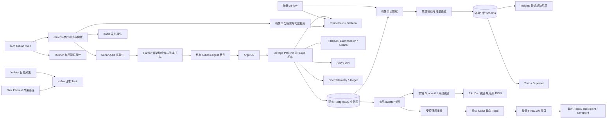

# Petclinic 业务统计与私有发布链升级 · 2026-10-11

> 2026-10-24本轮完成：#188完整发布成功；1202条来源、年度925的Airflow正常/受控失败/自动重试成功/同批重跑四轮通过，Spark→Flink/Kafka→Trino/Superset真实对账。137旧卷已完整备份校验后按授权删除，指定旧镜像本地副本已核验清理。Spark Operator/Webhook保留，计算按需回收；外部通知送达与云Trino根因仍有限制。详见[本轮发布与验收](ANALYTICS-E2E-20261024.md)。

> 2026-10-23 后续：#167完整发布成功，三个K3s组件采集target及实际指标通过，三条发现缺失Critical告警已在Prometheus/Alertmanager恢复；历史失败Job及容灾容量告警保留。详见[监控修正记录](MONITORING-K3S-20261023.md)。

> 2026-10-23 核对：#165完整发布成功；Airflow四轮联合验收通过，周一02:30上海时间运行。证据、任务ID和操作见[最新验收](ANALYTICS-E2E-20261022.md)。后文较早状态按日期保留为历史。

> 2026-10-16 当前状态：磁盘元数据修复、内容比对及重启已通过；Alertmanager 内部接收/路由通过；生产 #147，双架构 Critical/High 均0（仍有 Medium/Low）；新 Spark 两次通过。联合 DAG 仍在验收，详见 [本轮执行记录](ANALYTICS-E2E-20261015.md)。以下旧发布数字与表格为历史阶段，不能代替当前现场；Spark Operator/Webhook 常驻保留。

核心升级与分批任务已实际验收；当前生产版本 `0.10.0-ci-131`，剩余限制明确列在末尾。完整组件清单、测量预算、重复运行/回滚步骤分别见 `PLATFORM-INVENTORY-20261011.md`、`RESOURCE-POLICY-20261011.md`、`OPERATIONS-20261011.md`。

|发布身份|实际结果|
|---|---|
|Jenkins|#131 SUCCESS，677.144s；94项Java/29项Node通过|
|源码|`edf55ae34356f89315de3dafcf751a1c70a45ccc`|
|Sonar|质量门OK，新代码覆盖率92.1%，新增违规0，新增重复0%|
|Harbor OCI index|`sha256:b4106f65256a5c7164a9ccdc2e1696462ec18cc472da2ad71eae64dc5c08f533`|
|GitOps晋升|`d49cc9670836098d68466ef1906f51185f6ba601`|
|生产|发布验收时3个新副本Ready、重启0；随后VM重启恢复后仍为3/3 Ready（各保留1次重启记录），关键业务路径200、敏感actuator路径404|
|数据|owners200、pets350、vets20、visits1200不变；年度登记就诊923；演示来源明确|
|回滚/恢复|实际GitOps回滚`9a2f7dee2ce091c6961fd51f4c673786e5a4a6ec`，恢复`cc19a4b628e20dc9dfca64333821586d0082d46b`；隔离schema保留兼容|

原始证据与数据库/凭据备份保持私有，仓库只保存已审查源码、配置引用、汇总和操作说明。

## 已完成的具体变更

- 保存原工作区 HEAD、未提交 patch和清单；另建隔离工作树，保留原用户修改及未推送历史。
- Redis原件备份/校验后，在备份副本核实末尾135个零字节损坏，经用户明确授权才截除原AOF该尾部；前面的有效记录字节不变。Redis实际BGSAVE成功、AOF写入正常，Harbor各组件health=healthy。未变更Redis版本/架构、PVC或现有镜像。
- 私有GitLab `root/petclinic-platform` 已从镜像改为源码/发布主来源；现有Jenkins任务及历史保留、SCM改用现有GitLab凭据、添加Petclinic视图；Argo同一应用迁移到同一私有来源。迁移时保持原业务镜像和数据库不变，不推送内部资料至公开GitHub。
- 新增 `/insights`：日期筛选、登记就诊趋势、宠物类型分布、业务汇总、最近成功更新时间，明确演示数据、部分覆盖、空数据、加载和失败状态。分析失败保留成功结果，核心业务不依赖分析服务进程。
- PostgreSQL一致性custom dump先于新增schema；仅新增隔离 `petclinic_analytics` schema、分析/只读角色。分析账号仅SELECT业务表，结果独立发布；业务表DDL、已有记录和PVC均保留。
- 真实有界任务读取1200条已有就诊记录，以主键增量、去重、校验、事务发布；重复执行不重复计数。现有源数据时间范围2008-09-04至2026-10-01，2026年窗口923条；总业务计数200/350/20/1200。记录明确为此前生成的演示业务数据，不能称实际临床数据。
- 0.10版流水线保留双架构本地构建缓存和Harbor归档，生产晋升改为Harbor OCI digest；扫描完成与扫描请求分别记录，只有两个运行时架构实际扫描成功后才晋升。GitOps提交保留源码SHA，并同时使用[skip ci]和[ci-skip]避免提交循环。

## 流程

## 保护与回滚

原始证据私有存于 `/Users/zhangsir/code/evidence/platform-20261011`，主机备份 `/opt/petclinic-observability/backups/platform-20261011`。Redis原始4个文件及SHA256清单、修复前Deployment、Superset worker配置、Jenkins原XML、Argo原对象、Petclinic数据库custom dump均保留。

应用回滚通过私有GitLab普通revert晋升提交、Argo同步，再revert回滚恢复目标版本。新增schema对旧应用兼容，回滚应用不删除分析schema或业务数据。恢复数据库仅是另行批准的灾难恢复步骤，不将备份恢复覆盖作为发布回滚。

Redis回退如确有必要：先停止单个Redis Deployment并确认退出，将本轮之后的文件另行一致性备份，再使用备份原文件精确还原并恢复原副本数；原文件仍含已知损坏，回退会重新造成Harbor不可用，不作为正常应用回滚。不得关闭stop-writes-on-bgsave-error或重建PVC。

私有源码切换回退：使用备份中的Jenkins SCM及Argo源字段，仅恢复这两处，保留仓库历史和私有数据；不得把本轮私有提交推向公开GitHub。Cook继续独立私有GitLab→Jenkins/Harbor/Argo和经审查公开导出→Actions/Pages。

## 验收状态

正常业务发布、GitOps 回滚及恢复、Harbor 两架构扫描/目标拉取、Airflow 四轮真实调度、Trino/Superset 查询、Spark 统计、Flink 状态恢复及 Cook 浏览器回归已取得证据。补丁发布和完整盘点已补齐，结果见上表；云端 Trino 并发数据交换、通知送达与历史日志保留仍有明确限制。

### 发布后真实功能验收

Jenkins #127 完成，源码 `89e9fce138831b9510122c7d26beb9850bf21642`，GitOps `7bc825c3b7217b7750c9fde3ca02b94a7572d0bb`，镜像索引 digest `sha256:afc0a318404256f84a3381256c8730067d92b02fc41efc756f6b9cced2547f7c`。三个 ARM64 业务副本 Ready，Argo CD Synced/Healthy；核心表仍为 owners=200、pets=350、vets=20、visits=1200。

上线后浏览器发现应用角色缺少统计 schema 权限，已通过 `infra/analytics/grant_app_readonly.py` 最小修复：仅 schema USAGE 和 runs/daily_visits/pet_types SELECT。未授予原始事实表读写权限。年度筛选显示 923 条记录，类型汇总 350；明确标注演示来源。桌面、手机无溢出、空数据、日期校验及浏览器错误检查通过。

GitLab Jenkins 插件只识别 `[ci-skip]`，仅 `[skip ci]` 触发重复 #128，已在部署前中止。后续 GitOps 提交同时携带两种标记，保留 GitLab 原生与 Jenkins 插件兼容性。主依据：https://github.com/jenkinsci/gitlab-plugin/blob/master/src/main/java/com/dabsquared/gitlabjenkins/trigger/handler/push/PushHookTriggerHandlerImpl.java 。

Harbor 扫描功能通过，不代表无漏洞：#127 两架构各有 298 项（Critical 5、High 20、Medium 197、Low 72、Unknown 4，256 可修复）；保留报告以继续评估依赖与基础镜像修复。

### 2026-10-12 实际分析验收

Airflow 3.3.0 的真实 KubernetesExecutor 完成四次 DagRun：`manual__platform_20261011T160415_none`、`manual__platform_20261011T160529_retry`、`manual__platform_20261011T160714_timeout`、`manual__platform_20261011T161019_none`。正常、失败重试、90 秒超时重试和重复执行均成功；两次探测的 bounded_read 尝试次数实际为 2。事实表仍为 1200 个唯一 visit_id，四轮新输入均为 0，年度汇总均为 923。StatsD 已产生真实任务持续时间、尝试与成功样本，ServiceMonitor 已接入；所有 Airflow 计算副本和临时控制 Pod 已关闭。

Trino 483 通过独立只读 PostgreSQL 角色访问汇总 schema，保留原有 catalog。先在协调器和 UCloud worker 模式完成四个查询：`20261012_003843_00000_p6uuk`、`20261012_003850_00001_p6uuk`、`20261012_003908_00002_p6uuk`、`20261012_003912_00003_p6uuk`。Superset 并发查询出现 30 秒超时，CPU 消耗仅 14–59ms，主要处于阻塞状态；未据此猜测网络根因。改为已有协调器参与本地执行、云 worker 按需关闭后，同口径查询耗时 0.759–3.738s，Query ID 为 `20261012_005613_00000_7wg9i`、`20261012_005616_00001_7wg9i`、`20261012_005620_00002_7wg9i`、`20261012_005620_00003_7wg9i`。仍为年度 923、类型 350、来源就诊 1200。两组件 requests 等于完整进程内存 limit 2Gi；保留变更前私有备份。

Superset 保持现有 6.1.0 和原有 MySQL 元数据库/密钥，仅在原镜像上加入 ARM64 psycopg2-binary 2.9.13、trino 0.340.0，保留 mysqlconnector 9.6.0。新镜像 `sha256:aa3c7e2993de3d60aeab155e34071df87cff7a5dda5ec6e125e38b4b62c8f0ed`。原元数据已保存 SQL 备份及 SHA256。真实看板 `/superset/dashboard/petclinic-analytics-20261011/`（Dashboard 1、Charts 1–4）展示趋势、类型、年度总数和最近成功结果来源/时间；四个实际 Chart API 返回成功，923/350 与分析结果一致，浏览器无 JS 错误。同步查询有 60s 执行、90s 总时间上限，Celery worker 保持 0，临时管理 Pod 用后关闭。

真实 `/insights` 请求 trace `cffeddc45fe9283f92664b11de8eabff`、span `259929c9352229bb` 已在 Jaeger 查得，在 Elasticsearch 和 Loki 同时检索到；ES 中 service.version 为 `0.10.0-ci-127`、route 为 `/insights`、status 为 200。Grafana 已通过实际 datasource query 返回 Pod Ready 和 Hikari 样本。新分析告警三个规则实际 health=ok/inactive，0 期望副本不误报。通知送达未验证。

现有日志策略：Filebeat data stream 使用既有 ILM `filebeat`，hot rollover 30d/50GB、delete min_age 30d；另有一个旧 `filebeat-7.17.10` 索引未受 ILM 管理。Loki 未配置 retention_period/retention_enabled，本轮未改变既有删除策略；需要单独审查历史日志保留与清理。

Kafka 4.3.1 原来未挂数据卷，`/tmp/kafka-logs` 位于容器可写层。本轮确认此方式不能跨容器重建保留数据后，使用现有虚拟机磁盘 hostPath 持久化。受控维护期间短暂暂停 broker 主进程，保存完整归档后立即恢复；保留原始归档、独立恢复副本和逐文件 SHA256，未清除任何旧 Topic 或日志。归档 2307098 字节，SHA256 `98460f1927df1ef78c7c69193d9bdcc2ba97a3e8d6d9c1240d096a8d9d67b4c5`；重建后 `jenkins-logs:0=2189`、`petclinic-release-v09:0=1` 与迁移前一致。最终复验发生在VM于2026-10-12 14:59 CST重启并恢复之后：broker Ready、版本4.3.1，`jenkins-logs:0=2189`仍保留，并从 `petclinic-release-v09` 实际消费到 `0.10.0-ci-131` 的 `release_deployed` 事件，Topic末端位置为2。数据目录位于 `/opt/petclinic-observability/state/kafka-20261012T010132/data`，原 Kafka 镜像版本不变、单副本 Recreate、完整进程 requests=limit=1Gi。原 168h、1GiB segment、300000ms retention check 均保留。此为单节点磁盘持久化，不代表跨节点高可用。

Spark 实际引擎来自已安装 Operator 2.5.1 镜像中的 Spark 4.0.1；镜像 OCI 环境及任务运行均确认版本。Operator 入口不能处理 driver 参数，因此保留原 15 个文件系统层，仅将派生任务镜像 ENTRYPOINT 改为镜像内原有 `/opt/entrypoint.sh`。任务镜像 digest `sha256:711ace285d47914adfeec1a4db16d30632cade0717c971e9049d4adf59dcb500`，原 Operator 版本未变，未新增 Hadoop。

业务快照 1200 行，CSV SHA256 `5c30446631088ce2e666aeafe39c96dfcaef8d4b29a111ecedd079ea1ad847bb`。首个成功 Spark Application `spark-9e7247b023984ac79173111656581826`，Job IDs 0–9，年度 923，耗时 26.066s。为补齐短生命周期 executor 的峰值取证，再执行带实际分区资源探测的同口径任务：Application `spark-2b1ca37754cc4667aa92977e1cff9844`，Job IDs 0–10，年度仍为 923，耗时 29.149s；内核 memory.peak：driver 515.14MiB，覆盖全 1200 行的 executor 398.38MiB。每个 driver/executor 完整进程内存 request=limit=1Gi，Operator controller 1Gi、webhook 256Mi，总准入 4096MiB + 1250MiB 预留。任务、driver/executor、Operator 均在完成后正常关闭，快照 ConfigMap 和私有输出保留。

### Flink 实际窗口与恢复

沿用 Flink 2.3.0/Java 17 和已有 Kafka connector 5.0.0-2.2.jar；当前组合通过本轮有界任务，不将其扩展为官方兼容性保证。输入为 1200 行真实数据库快照的受控演示重放，非 CDC、非在线临床事件。Job IDs `486e32aa6f0fbf7dc245af3dd6acd7d7`、`c05ddd26e436502e1436dcb5d88769c0`。首次完成 3 次 checkpoint，经实际 savepoint 恢复后再处理第二个 replay scope，每轮年度窗口均为 923，完整输出每轮 1200；同一 scope 无重复最终键。消费提交位置 2400、末端 2400、lag=0。

两次正常 stop-with-savepoint：`savepoint-486e32-b85afc74fea0`、`savepoint-c05ddd-0f837402ddac`，状态目录 `/opt/petclinic-observability/state/flink/petclinic-window-092657`。使用独立 1Gi SQL 客户端、1Gi JobManager、1.5Gi TaskManager（一 slot），全部进程预算 4096MiB +1250MiB 储备；计算完成后正常关闭，保留状态及 Topic。原 Kafka 日志链路真实消费了 Jenkins 和 Flink 文件日志；Kafka Filebeat 只采集 Flink 路径，不冒称全 Kubernetes 日志流。临时验收消费者已关闭，无长期 Kafka→ES 消费转发器证据。

### Runner 与安全补丁

发布 #127 的 GitLab 原生 pipeline 250 初次 job 639 因 Pod 准备等待 180s 超时，重试 640 实际成功（59.76s），确认源码 `89e9fce138831b9510122c7d26beb9850bf21642`。重试事件证明 helper 首次外部拉取耗时约 50s；不能将首次失败推断为云节点失联。有效配置来自 Secret，原为 Runner 19.2.0 配 helper 16.11.0。已保留 Secret 0600 备份，使用官方 OCI 摘要校验的 ARM64 19.2.0 helper `sha256:e5fbc428f53a3fec19fb685d81e81e86cd6c054458887f8f8235c95f8390d743`，沿用已有 local-registry；控制器实测60MiB、完整 request=limit=128MiB，单任务并发，原注册/权限与 Cook 任务保留。Petclinic Runner 仅轻量源码审计，128MiB build +128MiB helper，2分钟截止，不重复部署。

已发布补丁升级 Spring Boot 4.1.1（Spring Framework 7.0.9、PostgreSQL JDBC 42.7.13），Tomcat 11.0.26、Jackson BOM 3.1.7；版本已在官方 Maven 仓库核实。本地 Java 回归92项（2项容器测试跳过）、Node29项通过。最终#131在容器环境94项全部通过；#129的Gauge弱引用问题和#130的新增代码违规被门禁真实阻止，修复后重新发布，保留失败记录。

新增分析结果可用性、读取失败、最近成功时间、窗口总数指标；新增实际 Jenkins 最近完成构建、耗时、结果和当前构建状态指标。平台快照读取既有凭据仅在服务器内存中执行一次有界 HTTP 查询，不在小内存 relay 启动额外 Node 进程；无数据时 NaN，不伪造成功。既有工具新增名称不再中断快照采集。发布与分析 Grafana 看板使用实际 PromQL，跨业务副本数量取 max。

### 最终补丁与可观测性复验

#131两架构实际扫描均Success/100%；每架构282项：Critical0、High14、Medium192、Low72、Unknown4、240可修复。相比#127的Critical5/High20，已修复本轮选择的Spring/Tomcat/Jackson/JDBC依赖；扫描结果仍有高危，不能宣称镜像无漏洞。完整报告保留私有。补丁晋升后Argo比较缓存一度停留旧修订；确认私有main已到晋升提交后，刷新比较缓存，由原自动同步逐个发布，未直接改业务Deployment。所有新副本、Endpoint、核心业务、数据库计数和管理暴露范围均复验通过。

最终浏览器仍为年度923、类型350、演示来源/更新时间明确；客户端日期校验、服务端400、空窗口0、手机390宽无溢出、无JS错误。`petclinic-insights-browser-131/result.json`和截图保留。新增发布/分析Grafana `petclinic-release-analysis` 18个面板已逐个调用真实data source query，全部返回样本；包括响应P95/请求速率/5xx、PodCPU内存、JVM/Hikari、Jenkins编号/耗时/结果/构建中、统计窗口/时间/失败、Airflow成功/重试/耗时历史及按需期望副本。Airflow计算关闭时从过去24h实际StatsD采样读累计，窗口过期显示无数据，不伪造常驻。

新实际请求trace `d019c452c641f03001cf3ef53075ebc5`：Jaeger1 span、ES1命中、Loki1 stream，版本`0.10.0-ci-131`。Kibana本轮保存搜索 `petclinic-upgrade-20261011-logs` 已建立，真实日志支持版本/Pod/时间/trace查询。正常关闭Spark/Flink/Airflow不误报；通知送达未验证。

CoreDNS实际跨namespace服务解析、metrics-server3节点资源API、kube-state-metrics实际3业务副本、node-exporter3节点MemAvailable样本均通过。MySQL8.4.10复制IO/SQL Yes、延迟0、错误0，本轮不用它作分析源。Portainer Kubernetes实例状态API200/版本2.39.5，登录后管理功能未验收。两个system-upgrade现有Plan Complete/Validated；未触发升级。Hello旧default Ingress无有效后端返回503，已备份并以UID条件仅删除旧路由，使用ns-apps有效Service新路由恢复200，旧Service/业务数据保留。现有FlareSolverr3.5.0在768Mi完整预算内实际浏览器取回本地Cook页面（200、3680字节、7.61s），外部挑战未作为本轮业务前置依赖。

Cook本地与GitHub Pages的12个菜谱、正文、图片、搜索/筛选/随机、导航/刷新、桌面与手机布局均通过已有浏览器证据，源码与发布流程保留；已知失效上游图片继续按原方式明确标注。原工作树用户未提交修改未覆盖。本輪新增内部内容只推送私有GitLab。

### 保留的限制与未完成项

- Airflow联合Spark/Flink需要9442MiB含储备，最近构建前8627–8832MiB不足，联合编排未准入；三者各自真实任务已验收并关闭，无长期重任务定时器。
- Trino云worker并发数据交换阻塞根因未确认，生产看板使用已验证本地协调器；云worker0，三个节点短时Ready不代表长期跨云高可用。
- 双架构仍各14个High漏洞，基础镜像/剩余依赖需按报告逐项升级和兼容性验证；不通过禁用扫描/修改报告冒称修复。
- 告警规则已验证，通知送达未验证；Loki自动retention及旧ES索引历史清理未配置，本轮未修改持久日志删除策略。
- Portainer登录后管理、Dex/通知/ApplicationSet无本轮完整实际使用；JKVideo页面HTTP已验证，第三方视频播放未验收。MinIO/Kafka UI/OpenClaw/Zabbix按需关闭，不为展示启动。历史三个Application目标namespace缺失，属于配置存在但未部署。
- Kafka hostPath与Flink file状态为单节点持久化；没有长期Kafka→ES消费转发器，Flink输入是演示快照重放而非CDC。Hadoop/HDFS和MongoDB未安装，本轮不新增。

## 2026-10-19 学习平台第一项交付

独立cert-manager/HTTPS实验经私有GitLab及Jenkins #153完整发布后，10月18日通过签发、CA校验HTTPS、证书及密钥换发、重复同步、失败负例及Prometheus验收。详见[学习平台记录与后续缺口](DEVOPS-LEARNING-20261019.md)。本条不将此前未完成的四轮联合分析或公网ACME改写为完成。

## 2026-10-20 发布实验完成

私有源码6aa3faf经Jenkins #159完整发布，修正副本灰度非法延迟缩容及CRD端口TCP默认差异，增加语义校验/负例和官方CLI lint。独立发布实验完整正常/失败/重试/重复执行/蓝绿/清理已实测通过；这与Petclinic本体改为灰度发布、此前未完成的联合分析是不同事项。[完整证据与剩余限制](ROLLOUTS-LAB-20261020.md)。
