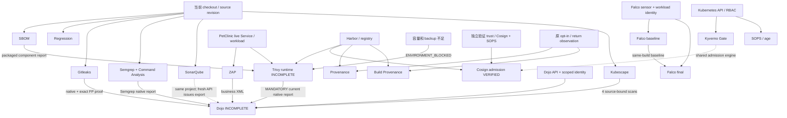

# 当前 Runtime 依赖图

仅描述当前代码中的耦合。箭头 `reports` 表示必须读取的报告；虚线表示共享外部观察，不表示依赖前一 Gate 结果。顺序执行本身不构成数据依赖。

| Canonical source | 当前执行 / 观察关系 | 实际前序 source 报告输入 |
|---|---|---|
| sbom | BUILD_ANALYSIS | 无；外部 prerequisite 见 JSON |
| regression | INDEPENDENT_LOCAL_TEST_EXECUTION | 无；外部 prerequisite 见 JSON |
| falco-baseline | SHARED_OBSERVATION | 无；外部 prerequisite 见 JSON |
| kyverno | EXTERNAL_POLICY_VALIDATION | 无；外部 prerequisite 见 JSON |
| kubescape | INDEPENDENT_SCANNER_EXECUTION | 无；外部 prerequisite 见 JSON |
| gitleaks | INDEPENDENT_SCANNER_EXECUTION | 无；外部 prerequisite 见 JSON |
| sops | INDEPENDENT_CREDENTIAL_VALIDATION | 无；外部 prerequisite 见 JSON |
| trivy | EXTERNAL_SCANNER_EXECUTION_ENVIRONMENT_BLOCKED | sbom |
| cosign | INDEPENDENT_SIGNATURE_ADMISSION_VALIDATION | 无；外部 prerequisite 见 JSON |
| sonarqube | EXTERNAL_SCANNER_EXECUTION | 无；外部 prerequisite 见 JSON |
| zap | INDEPENDENT_SCANNER_EXECUTION | 无；外部 prerequisite 见 JSON |
| falco-final | SHARED_OBSERVATION_WITH_BASELINE_DEPENDENCY | falco-baseline |
| defectdojo | REPORT_AGGREGATION_PIPELINE_COUPLED | trivy, kubescape, gitleaks, semgrep-command-audit, zap |
| provenance | CONDITIONAL_WORKFLOW_HELPER | 无；外部 prerequisite 见 JSON |
| build-provenance | CONDITIONAL_WORKFLOW_HELPER | 无；外部 prerequisite 见 JSON |
| semgrep-command-audit | INDEPENDENT_COMBINED_SCANNER_EXECUTION | 无；外部 prerequisite 见 JSON |

Dojo 的六种 parser 是固定集合的一部分，不能据此将 mandatory Trivy 替换为其中任意一种。通用 manager/tool 分支支持 enabledModules 选择，但生产 petclinic adapter 不选择该分支。

`PIPELINE_COUPLING_DEBT`：Dojo 直接依赖 `.devsecops/*` 私有路径、上游顺序和平台 scope。`DOJO_DECOUPLING_REQUIRED = YES`。未来目标为 scanner → Manager → normalized result/report → Result Router → Dojo；本轮只记录，不实现。

Provenance / Build Provenance 的外部依赖仅在既有显式 enabled 分支中成立；既有 SKIPPED 观察保持原含义。Cosign 当前 admission 使用自己的验证 fixture，不把 release 模式中的 Trivy 依赖错误套到 admission 上。
