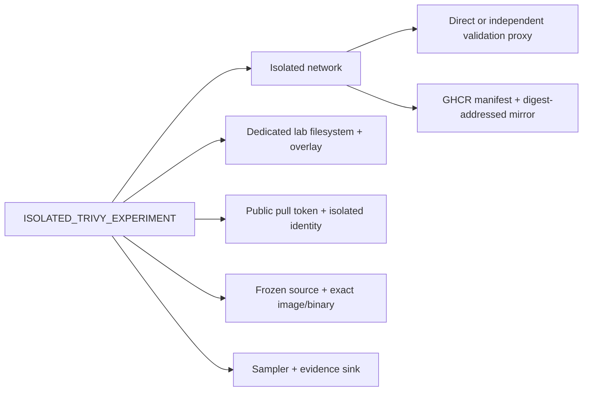

# 已封存设计的依赖图（补充复核）

生产 v2rayN/xray、Mac10808、Mac LAN代理、生产 VM网络、生产 Harbor运行时、生产凭据/缓存均无必需执行依赖边。可选的镜像获取与运行依赖分开记录。

| Dependency | Classification | Required | Rationale |
|---|---|---|---|
| ISOLATED_TRIVY_EXPERIMENT | VALIDATION_ONLY | True | Root isolated workflow; not production release |
| Isolated egress, DNS and TLS | VALIDATION_ONLY | True | Independent egress allowed in sealed design; production endpoints denied |
| Direct access branch | OPTIONAL | False | One alternative to independent validation proxy; not yet proved reachable from a selected lab |
| Independent validation proxy for manifest fetch | OPTIONAL | False | Explicitly supported alternative; mirror download still follows frozen proxy-clearing command |
| GHCR official manifest/token + ghcr.nju.edu.cn digest-addressed DB layer | VALIDATION_ONLY | True | Both source identities needed; public read-only services, not production Harbor |
| Dedicated lab storage / ext4 / overlay / same-device cache+temp | VALIDATION_ONLY | True | Same properties, not same physical production disk/PVC |
| Public anonymous scoped pull token and isolated Kube/Lease identity | VALIDATION_ONLY | True | Only lab identity; public token generated by frozen path. No token fetched in this review |
| Exact frozen wrapper, image and binary | VALIDATION_ONLY | True | Source copies immutable and local hashes verified; lab image availability not yet attested |
| 10ms sampler + allocation tracing + evidence sink | VALIDATION_ONLY | True | Specification exists; executable calibrated tool deployment is execution prerequisite |
| CURRENT production v2rayN | NOT_REQUIRED | False | Sealed design explicitly excludes production runtime dependency |
| CURRENT production xray | NOT_REQUIRED | False | Exact Trivy semantics require artifact route, not current production proxy identity |
| Production Mac 127.0.0.1:10808 | NOT_REQUIRED | False | Previous public-source research transport only; not experiment execution input |
| Mac LAN proxy path | NOT_REQUIRED | False | Not selected; sealed design uses direct or independent validation path |
| Production devops VM network/API | NOT_REQUIRED | False | Hardcoded harbor/data-infra/devops names reproduced only inside isolated API; prod access denied |
| Production Harbor runtime/registry mutation | NOT_REQUIRED | False | No Harbor service used by DB fetch; exact image may be preloaded read-only, lab transfer proof still needed |
| Offline/read-only transfer of exact image | OPTIONAL | False | Acquisition transport not fixed. Existing local registry may be read-only source if separately authorized; production current Harbor health is not guard experiment input |
| Production Secrets / kubeconfig / registry credentials | NOT_REQUIRED | False | Explicitly forbidden |
| Production Trivy DB/cache/PVC | NOT_REQUIRED | False | Lab uses public disposable seed; no cache sharing |
| Current production proxy matches epoch | NOT_REQUIRED | False | Safety reporting obligation is separate from isolated experiment readiness |
